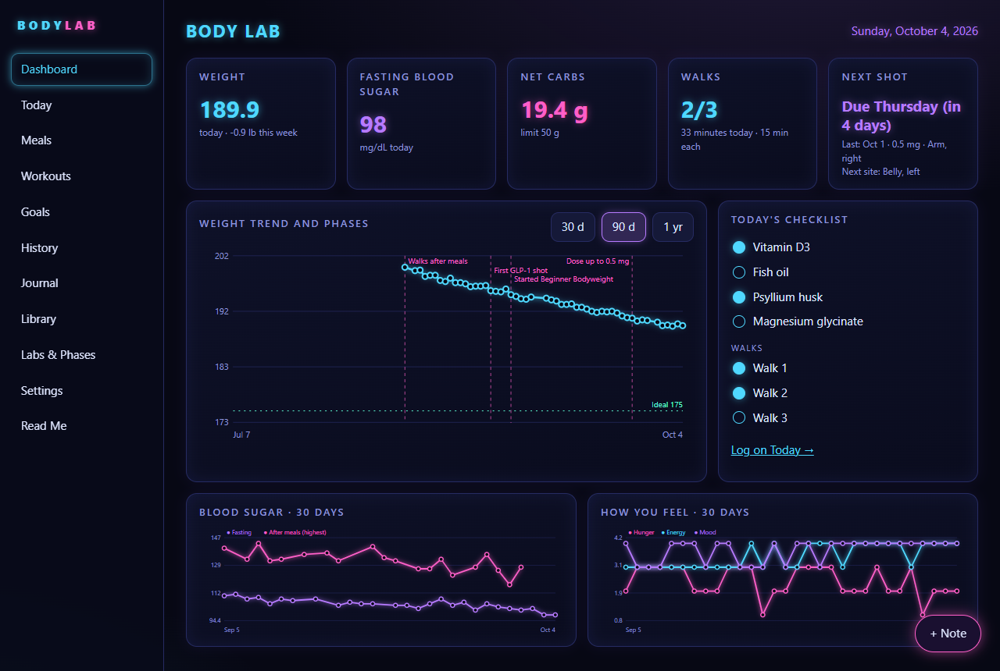
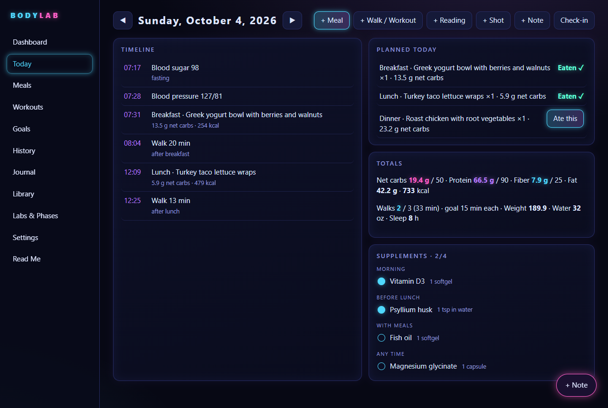
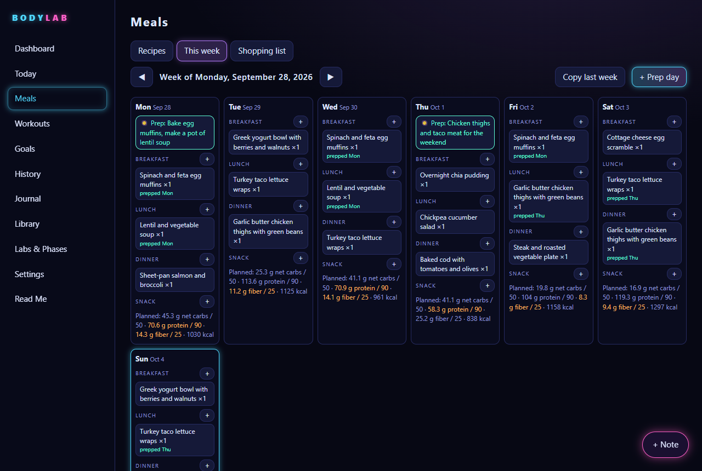
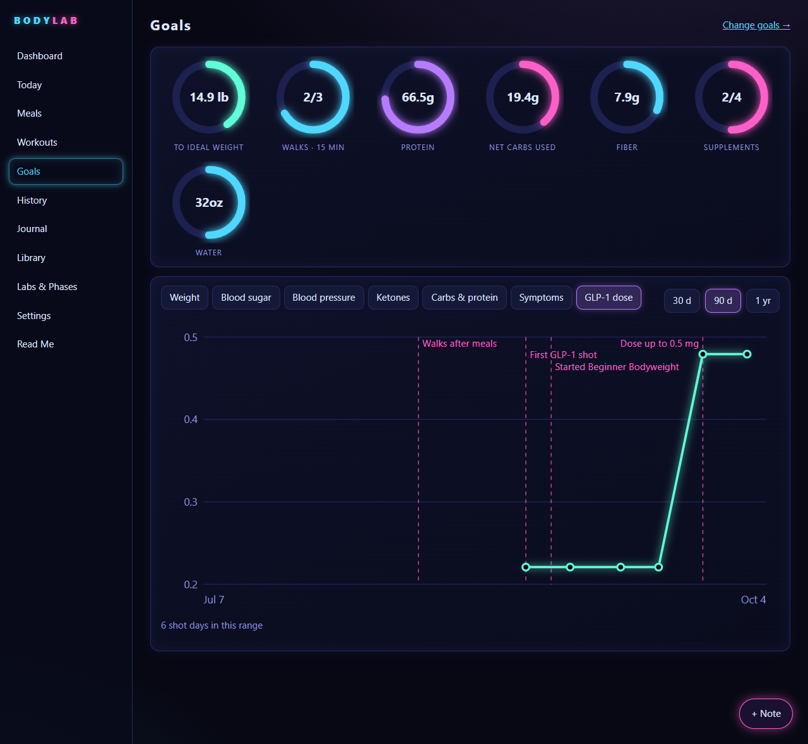

# Body Lab

Body Lab is a dashboard for running your own health experiment. You log what you eat, your readings, your walks and workouts, your supplements and how you feel. Body Lab turns that into charts, so you can see what changed after each thing you tried.

**Body Lab has been tested on Windows only. The Mac files haven't been tried on a Mac yet.**



## Contents

- [What Body Lab is](#what-body-lab-is)
- [What you need](#what-you-need)
- [Download](#download)
- [Set up on Windows](#set-up-on-windows)
- [Set up on a Mac](#set-up-on-a-mac)
- [Using it](#using-it)
- [How it works](#how-it-works)
- [Using Claude or ChatGPT](#using-claude-or-chatgpt)
- [Keeping your data private](#keeping-your-data-private)
- [Changing or removing the schedule](#changing-or-removing-the-schedule)
- [Troubleshooting](#troubleshooting)
- [Try it with sample data](#try-it-with-sample-data)
- [Why it's built this way](#why-its-built-this-way)
- [Credits and license](#credits-and-license)

## What Body Lab is

Body Lab is a personal dashboard for a health experiment. Maybe you're trying low-carb eating, walks after meals, a new supplement or a workout program. You record what you do and how your body responds, and Body Lab draws the charts.

**It isn't medical advice.** Body Lab records and graphs. It never tells you what dose to take or what to change. Talk to your doctor about your health.

Your dashboard starts empty. It comes with starter workout programs, diets and recipes, and it fills in as you log. All the pictures in this Read Me use made-up sample data.

## What you need

- A Windows computer. A Mac may work too, but it hasn't been tested yet.
- **Node**, a free program that Body Lab runs on. You install it once. You need Node 22.13 or newer, and the LTS download from the Node website is fine.
- Chrome or Edge, to show Body Lab in its own window. Windows already has Edge.

### Install Node

1. Go to [nodejs.org](https://nodejs.org) in your web browser.
2. Click the download button for the **LTS** version. LTS means "long-term support", the steady version most people should use.
3. When the download finishes, open it. On Windows the file ends in `.msi`. On a Mac it ends in `.pkg`.
4. Click **Next** through each screen, or **Continue** on a Mac, and keep the choices it suggests. Click **Install**, and say yes if your computer asks for permission.
5. When it's done, click **Finish**, or **Close** on a Mac.

You won't see a Node window or icon afterwards. That's normal. Node works in the background, and Body Lab uses it.

## Download

1. Go to the Body Lab page on GitHub, a website that stores the program's files: [github.com/HelloSteph1975/body-lab](https://github.com/HelloSteph1975/body-lab). Click the green **Code** button, then **Download ZIP**.
2. **Windows only:** find the zip file in your Downloads folder. Right-click it and choose **Properties**. Near the bottom of the **General** tab, tick **Unblock**, then click **OK**. This tells Windows you trust the file, so it lets the setup files run. If there's no Unblock box, Windows hasn't blocked the file and you can skip this step.
3. Open your **Documents** folder and make a new folder called **Body Lab**.
4. Unzip the download. On Windows, right-click the zip and choose **Extract All**. On a Mac, double-click it.
5. Inside you'll find a folder with a name like `body-lab-main`. Open it. If you see another folder with the same name, open that one too. You want the folder that has **Set up Body Lab** and **server.js** in it.
6. Move that folder into your **Body Lab** folder and rename it **App**.

When you're done, it should look like this:

```
Documents
  Body Lab
    App
      Set up Body Lab
      Remove Body Lab setup
      Mac
      server.js
      ...
```

Why two folders? Body Lab keeps your notes in the **Body Lab** folder, next to **App**. Everything inside **App** is the program. When a new version comes out, you replace only the App folder, and your notes stay where they are.

## Set up on Windows

1. Open **Documents**, then **Body Lab**, then **App**.
2. Double-click **Set up Body Lab**. You only need to do this once.
3. A black window opens and shows what it's doing. When it's finished, it lists what it set up and says **Press Enter to close**.
4. Body Lab opens in its own window. Read the black window, then press **Enter** to close it.

Setup does three things:

- It puts a **Body Lab Dashboard** icon on your Desktop. Double-click it any time to open Body Lab. If Body Lab is off, the icon starts it first.
- It makes Body Lab start by itself every day at 5:30 AM and stop by itself at 9 PM. This works on battery too. If your computer was off at 5:30, Body Lab starts once you turn it on and sign in.
- It opens Body Lab now, in a window with no tabs or address bar. It uses Chrome if you have it, and Edge if you don't.

You can run **Set up Body Lab** again at any time. It replaces the old Desktop icon and schedule instead of adding a second one.

On Windows you only need two files in the App folder:

| File | What it does |
|---|---|
| Set up Body Lab | Makes the Desktop icon and the daily schedule, then opens Body Lab |
| Remove Body Lab setup | Removes the Desktop icon and the schedule. Your notes are left alone. |

The **Mac** folder holds the Mac start and stop files. Windows doesn't use it.

You don't need to stop Body Lab yourself. It stops at 9 PM, and it's fine to leave it running until then. If you ever want to stop it sooner, go to File Explorer, open the App folder, click the address bar, type **powershell**, and press **Enter**. A PowerShell window opens. Type this line and press **Enter**:

```
powershell -ExecutionPolicy Bypass -File "setup\windows\stop.ps1"
```

It says **Body Lab stopped.** The Desktop icon starts it again.

## Set up on a Mac

**Body Lab has been tested on Windows only. The Mac files haven't been tried on a Mac yet.** If you try them, please share how it went.

1. Open **Documents**, then **Body Lab**, then **App**, then the **Mac** folder inside App.
2. Double-click **Start Body Lab**. A Terminal window opens, then Body Lab opens. It uses its own Chrome window if you have Chrome, and your usual browser if you don't.
3. The first time, macOS may say the file is from an unidentified developer. If so, right-click **Start Body Lab** and choose **Open**, then **Open** again. If there's no Open button, go to **System Settings**, then **Privacy & Security**, scroll down and click **Open Anyway**.
4. To shut Body Lab down, double-click **Stop Body Lab** in the same Mac folder.

There's no timed start on a Mac. Double-click **Start Body Lab** in the Mac folder whenever you want to use it.

## Using it

The menu takes you to each page.

| Page | What it's for |
|---|---|
| Dashboard | Today's weight, blood sugar, carbs, walks, and a weight chart with your experiment phases marked |
| Today | Log meals, walks, workouts, readings, shots and notes for the day |
| Meals | Recipes, a weekly meal plan and a shopping list |
| Workouts | Pick a workout program and track your progress |
| Goals | Rings for today's goals, and charts for weight, blood sugar, blood pressure and more |
| History | Look back over past days |
| Journal | Your notes over time |
| Library | Saved foods, your supplement plan, exercises and routines |
| Labs & Phases | Blood test results, and the start of each experiment phase |
| Settings | Your goals, your diet, GLP-1 tracking and backups |
| Read Me | This guide |

You'll spend most of your time on the Today page. The buttons along the top add a meal, a walk or workout, a reading, a shot or a note. The Shot button shows up once you turn on GLP-1 tracking in Settings.



The Meals page plans your week, including prep days, and builds a shopping list from the plan.



The Goals page shows how today is going and charts each measure over time. If you turn on GLP-1 tracking in Settings, a **GLP-1 dose** chart appears here too.



**Tip:** pin the window so it's always one click away. On Windows, right-click the Body Lab icon on the taskbar and choose **Pin to taskbar**. On a Mac, right-click the icon in the Dock and choose **Options**, then **Keep in Dock**.

## How it works

**The folder is the brain.** Every day, food, lab visit and recipe is a plain text note in your Body Lab folder. You can open the notes in any text editor, or in Obsidian, a free notes app. Each note starts with a properties block, a short section at the top that holds the note's data, one item per line. Make changes in Body Lab when you can. Each time it saves a note, it keeps the properties and rewrites the text below them.

**SQLite is the safety net.** SQLite is a small database file. Body Lab copies all your notes into one each day, at `Backups/body-lab.sqlite`, and keeps each day's copy for 30 days. To go back to an earlier copy, open **Settings** and go to **Backups**. Before it restores anything, Body Lab moves your current notes into a `.trash` folder, so nothing is lost.

**The code lives in the cloud.** The program itself is kept on GitHub. To update Body Lab:

1. Stop Body Lab. On Windows, use the PowerShell line under [Set up on Windows](#set-up-on-windows). On a Mac, double-click **Stop Body Lab** in the Mac folder.
2. Rename your App folder to **App old**.
3. Download the new zip and unzip it the same way as before, so you have a new **App** folder next to **App old**.
4. On Windows, double-click **Set up Body Lab** in the new App folder. On a Mac, open the **Mac** folder in the new App folder and double-click **Start Body Lab**.
5. Once Body Lab opens and your days are there, you can delete **App old**.

## Using Claude or ChatGPT

The first time Body Lab runs, it writes a guide called `How to add things.md` into your Body Lab folder. The guide explains how each kind of note is laid out.

Give that file to your AI tool, such as Claude or ChatGPT, and ask it to write a workout program, a diet or a recipe. Save what it writes as a `.md` file in the folder the guide names. Body Lab reads it the next time you open that page.

For example: "Using this guide, write a 4-week beginner walking and bodyweight program for someone over 50."

## Keeping your data private

- Your notes never leave your computer. Body Lab doesn't send anything anywhere, and other computers can't connect to it.
- The food list is built into the app, so looking up a food doesn't go online either.
- If your Documents folder is in OneDrive or iCloud, that service backs up your notes too.
- **Never upload your Body Lab folder to GitHub** or any other public site. It holds your health records.

## Changing or removing the schedule

On Windows, Body Lab starts at 5:30 AM and stops at 9 PM. To change those times:

1. Click **Start**, type **Task Scheduler** and open it.
2. On the left, click **Task Scheduler Library**.
3. In the list, double-click **Body Lab - Start Morning**.
4. Click the **Triggers** tab, then **Edit**.
5. Change the time and click **OK**, then **OK** again.
6. Do the same for **Body Lab - Stop 9 PM** if you want a different stop time.

Keep the task names as they are, even if the stop time is no longer 9 PM. Body Lab reads the times from these two tasks. If your computer was off at the start time, Body Lab starts when you sign in, but only if it is still before the stop time. If Windows can't read the schedule, it doesn't start Body Lab, so use the Desktop icon.

If you run **Set up Body Lab** again later, the times go back to 5:30 AM and 9 PM.

To remove the schedule and the Desktop icon, double-click **Remove Body Lab setup** in your App folder. A window lists what it removed and says your notes were left alone. Press **Enter** to close it.

To remove Body Lab completely, do that first. Then stop Body Lab with the PowerShell line under [Set up on Windows](#set-up-on-windows), or restart your computer, and delete the App folder. Your notes are still in the Body Lab folder. Keep it or delete it, as you like.

## Troubleshooting

**The window doesn't open.** Open your web browser and go to [http://127.0.0.1:4185](http://127.0.0.1:4185). If Body Lab shows up, it's running and only the window failed. If nothing shows up, double-click **Set up Body Lab** again. Its window stays open, so you can read any message it shows.

**It says "port in use", or that something else is using port 4185.** Another program is already using the address Body Lab needs. Restarting your computer often clears it. If it keeps happening, you can run setup with a different port number. In File Explorer, open the App folder, click the address bar, type **powershell**, and press **Enter**. A PowerShell window opens in that folder. Type this line and press **Enter**:

```
powershell -ExecutionPolicy Bypass -File "setup\windows\setup.ps1" -Port 4189
```

If you change the port, use the new number everywhere else too. Add `-Port 4189` to the end of the stop line, and open http://127.0.0.1:4189 instead of 4185 in your browser.

**Windows blocked a file.** If a blue box says "Windows protected your PC", click **More info**, then **Run anyway**. To stop it happening, go back to the zip, tick **Unblock** as described under [Download](#download), and unzip it again.

**It says Node isn't installed.** Install Node as described under [What you need](#what-you-need), then double-click **Set up Body Lab** again. If it still says Node is missing, restart your computer and try once more.

**It says Body Lab needs Node 22.13 or newer.** Your Node is too old. Install the LTS version from [nodejs.org](https://nodejs.org) the same way, which replaces the old one, then double-click **Set up Body Lab** again.

## Try it with sample data

This part is optional. It sets up a second copy of Body Lab filled with made-up data, so you can look around before you log anything of your own. It needs a terminal and works on Windows only. It doesn't touch your real notes.

In File Explorer, open the App folder, click the address bar, type **powershell**, and press **Enter**. A PowerShell window opens in that folder. Type this line and press **Enter**:

```
powershell -ExecutionPolicy Bypass -File "setup\windows\setup.ps1" -Demo
```

This makes about 8 weeks of sample data in a folder called `dev\body-lab-demo` in your home folder. It puts a **Body Lab Demo** icon on your Desktop and opens the demo. The demo has no daily schedule, and it runs alongside your real Body Lab.

The sample dates end on the day the data was made. If you're recording or showing the demo, rebuild it right before you start so the dates are current:

```
powershell -ExecutionPolicy Bypass -File "setup\windows\stop.ps1" -Demo
node tools\make-demo-data.js
```

Then double-click **Body Lab Demo** to open it again. To remove the demo icon, run `setup\windows\remove.ps1 -Demo` the same way, then delete the demo folder.

## Why it's built this way

This part is for readers curious about the choices behind Body Lab. Each one has a reason and a cost.

**Plain files instead of a database.** Your notes are text files you can open, read, copy and back up without Body Lab. If the app stops working, your data is still there. The cost is that Body Lab reads many small files, and a typo made by hand in a note makes Body Lab show a warning and leave that note alone until you fix it.

**SQLite only for backups.** One backup file is easy to keep and easy to restore from, and it doesn't change how your notes work day to day. The cost is that there are two copies of everything, and the backups only go back 30 days.

**It runs only on your computer.** Your health records stay with you, and there's no account, subscription or company server that could shut down. The cost is that you can't open it from your phone or another computer, and you have to install updates yourself.

**No npm packages.** Body Lab uses only what comes with Node. There's nothing extra to install, and no outside code that could break or be tampered with later. The cost is that the charts and other pieces are simple and home-made, with fewer features than ready-made ones.

**No framework or build step.** The files in the App folder are the program exactly as it runs. Anyone can read them, and there are no build tools to keep working. The cost is that some of the code is longer and more repetitive than it would be with a framework.

**Food data built in.** About 7,800 foods from the USDA come with the app, so looking up a food works offline and never sends what you eat anywhere. The cost is that it's a 2018 U.S. list, so newer and brand-name foods are missing. You can add your own foods.

**It records and never recommends.** Body Lab shows you what happened. Decisions about your health belong to you and your doctor. The cost is that it won't tell you what to try next.

**No VBScript.** Many small Windows launchers use VBScript to start a program without a window. Microsoft is removing VBScript from Windows, so Body Lab uses PowerShell instead. The cost is that a PowerShell window may flash for a moment when Body Lab starts.

Want it built differently? You're welcome to make your own copy and change it.

## Credits and license

**Support.** Body Lab is free. If it helps you, you can buy me a coffee:

[](https://www.buymeacoffee.com/stephaniebo)

The food data comes from USDA FoodData Central, SR Legacy:

Nutrition data: U.S. Department of Agriculture, Agricultural Research Service. FoodData Central, 2019. fdc.nal.usda.gov.

The data is a U.S. government work in the public domain, under CC0. Body Lab is not made or endorsed by the USDA.

Body Lab is free and open source under the MIT License. You can use, change and share it, as long as you keep the license file with it. See the LICENSE file.
